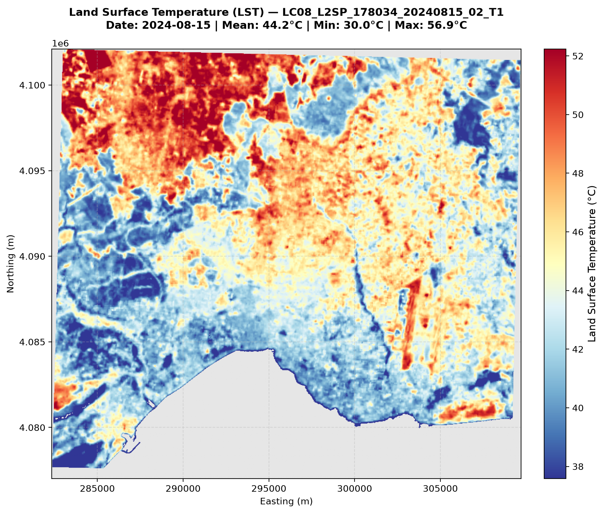
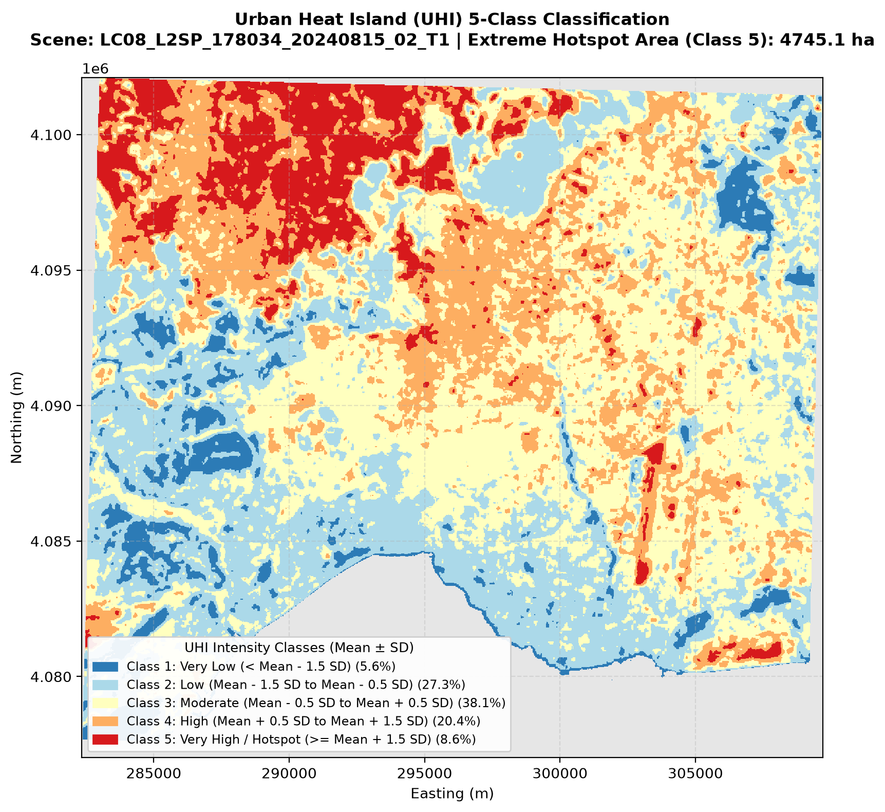
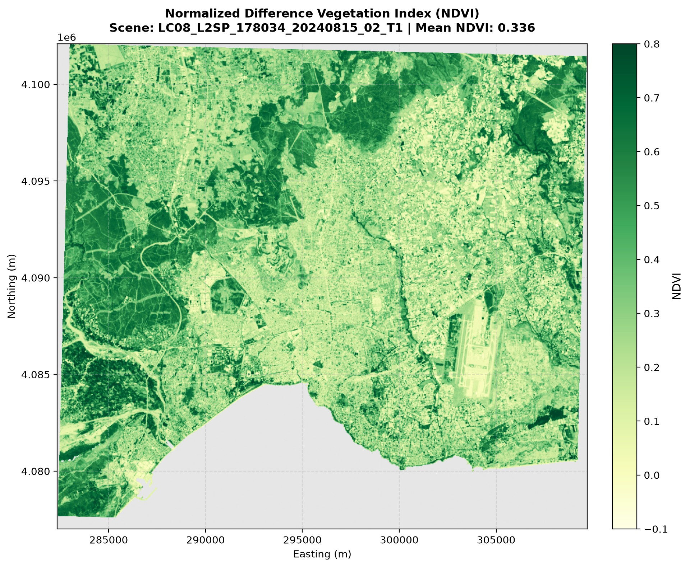
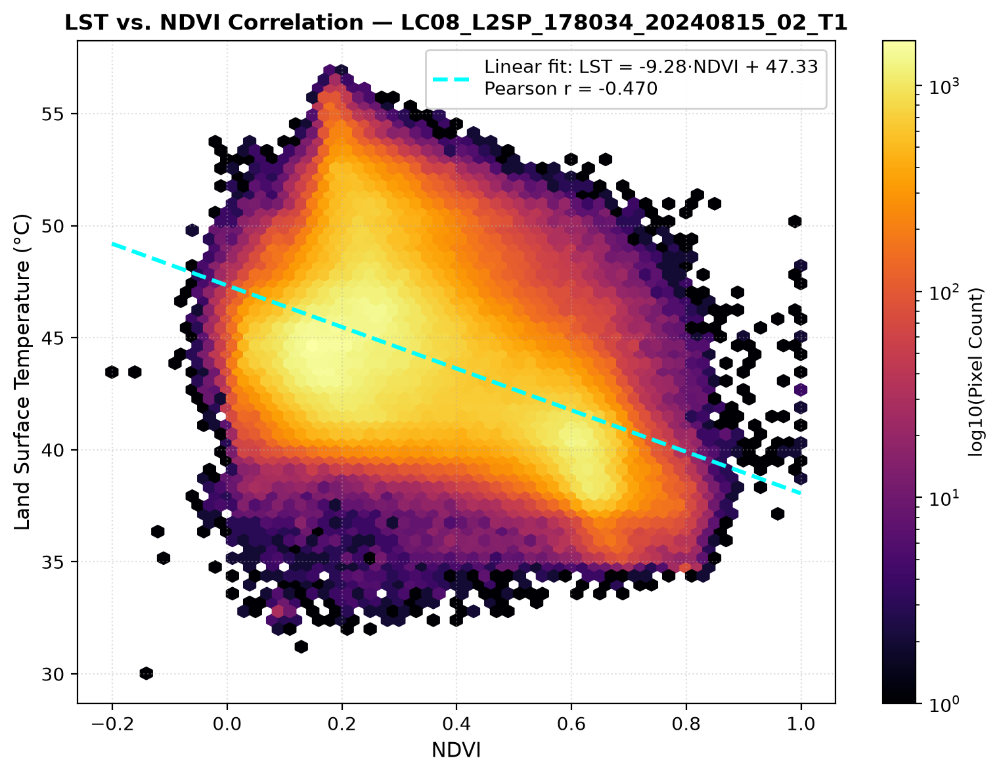
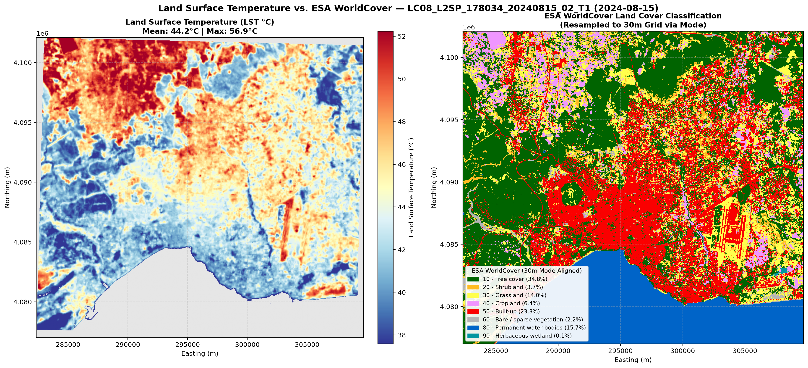
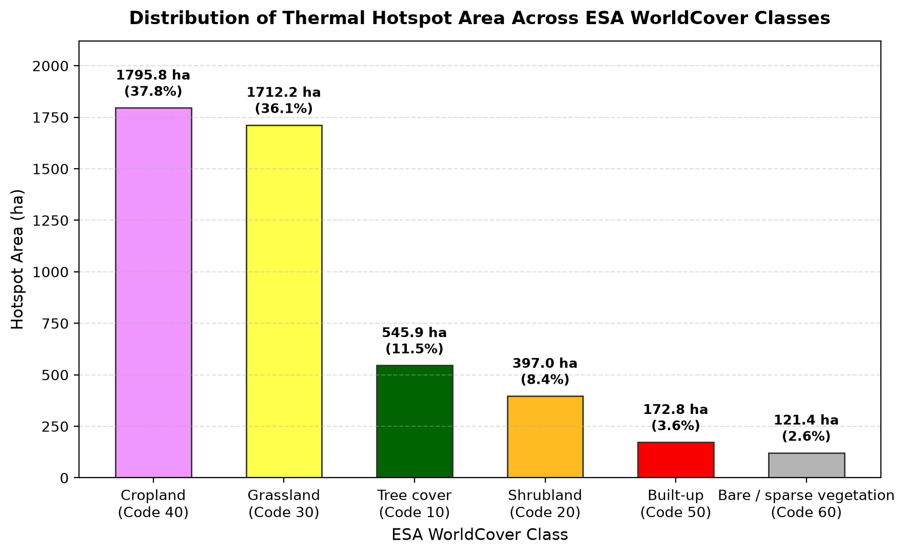
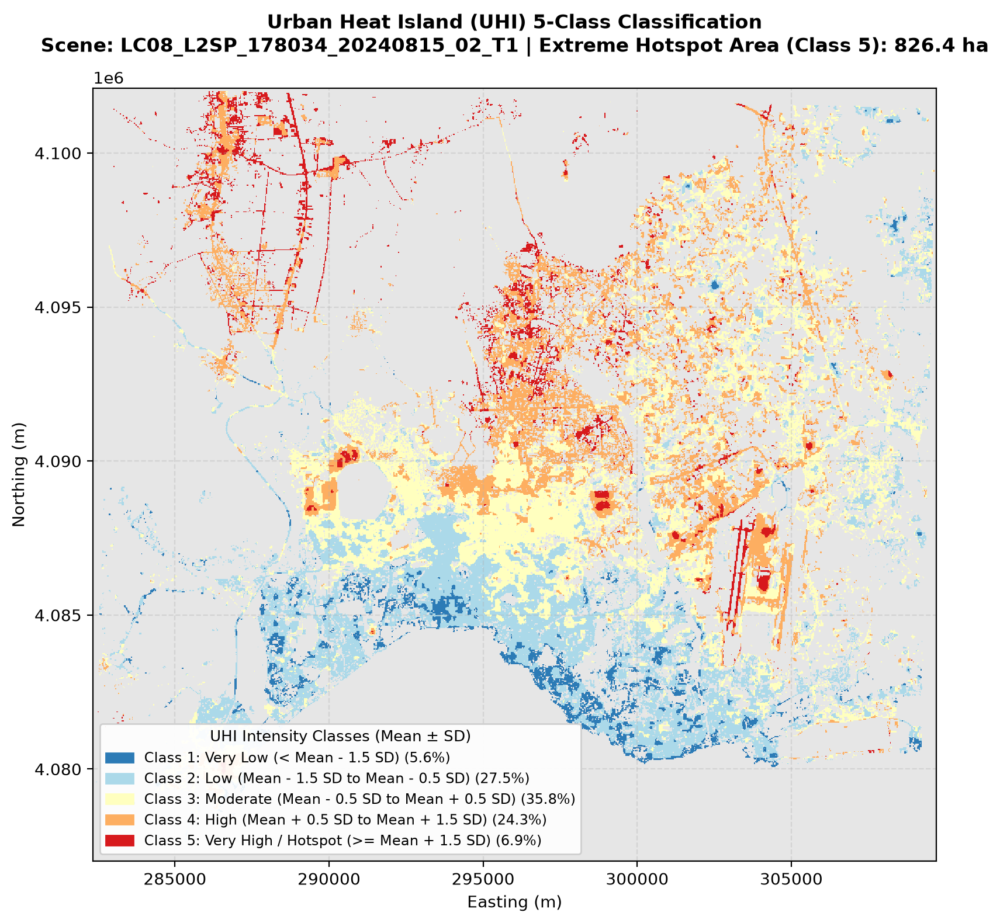

# urban-heat-lst

**Open-Source Urban Heat Island (UHI), Land Surface Temperature (LST) & ESA WorldCover Analysis Pipeline**

`urban-heat-lst` is a modular, command-line Python tool that automates the detection, classification, and mapping of Urban Heat Islands (UHI) using **Landsat 8 & 9 Collection 2 Level-2** satellite imagery and **ESA WorldCover (10 m)** land cover data streamed directly from the **Microsoft Planetary Computer STAC API**.

---

## Sample Results — Antalya Central Districts (15 August 2024)

| Land Surface Temperature (LST °C) | 5-Class Urban Heat Island (UHI — All Land Classes) |
| :---: | :---: |
|  |  |

| Normalized Difference Vegetation Index (NDVI) | LST vs. NDVI Correlation ($r = -0.47$) |
| :---: | :---: |
|  |  |

---

## Land Cover & Thermal Hotspot Analysis (ESA WorldCover)

Using `urban_heat_lst/landcover.py`, the pipeline retrieves the latest **ESA WorldCover** product (`2021 v200`), aligns it to the 30 m LST grid using categorical **mode (majority)** resampling, computes zonal LST statistics per land cover class (`outputs/landcover_lst_stats.csv`), and enriches every hotspot polygon in `outputs/hotspots.gpkg` with its dominant individual WorldCover class (`dominant_lc_code`, `dominant_lc_name`) and composition (`pct_urban`, `pct_agriculture`, `pct_bare`, `pct_other`).



| Hotspot Land Cover Distribution (`urban_only: false`) | Urban-Only UHI Classification (`urban_only: true`) |
| :---: | :---: |
|  |  |

### Per-Class Land Cover LST Statistics (Antalya — 15 August 2024)

| Code | ESA WorldCover Class | Area (ha) | Mean LST (°C) | Median LST (°C) | Std LST (°C) | Min LST (°C) | Max LST (°C) |
| :---: | :--- | ---: | ---: | ---: | ---: | ---: | ---: |
| `40` | **Cropland** | 4,111.29 | **48.26** | 48.87 | 4.02 | 35.38 | 56.91 |
| `20` | **Shrubland** | 2,399.31 | **46.51** | 46.44 | 2.99 | 34.76 | 54.88 |
| `30` | **Grassland** | 9,221.31 | **46.49** | 46.38 | 3.21 | 33.45 | 56.05 |
| `60` | **Bare / sparse vegetation** | 1,429.38 | **45.31** | 45.15 | 3.15 | 32.21 | 54.58 |
| `50` | **Built-up (Urban)** | 15,729.39 | **43.95** | 43.87 | 2.35 | 33.08 | 53.87 |
| `10` | **Tree cover** | 22,513.77 | **42.45** | 42.06 | 3.27 | 33.24 | 55.98 |
| `90` | **Herbaceous wetland** | 41.94 | **36.70** | 35.88 | 2.33 | 34.58 | 46.31 |
| `80` | **Permanent water bodies** | 69.93 | **36.44** | 36.17 | 2.55 | 30.02 | 46.56 |

### Interpretation / Yorum

- **English**: Because the Landsat 8/9 overpass occurs at approximately **11:30 local time** (`08:33 UTC`), the derived values represent **daytime Land Surface Temperature (LST)** rather than nighttime air temperature. In this daytime observation, harvested or dry agricultural fields (`Cropland`: `48.26 °C`) and dry herbaceous areas (`Grassland`: `46.49 °C`, `Shrubland`: `46.51 °C`) appear warmer than `Built-up` urban areas (`43.95 °C`). This pattern—where dry rural soils warm rapidly under morning solar radiation—is a commonly observed phenomenon in Mediterranean climates during summer. To evaluate thermal variations strictly within the urban fabric (`Built-up = 50`), enable `urban_only: true` in `config.yaml` ($\mu = 43.95\ ^\circ\text{C}$, $\sigma = 2.35\ ^\circ\text{C}$, `349` urban hotspots covering `826.38 ha`).
- **Türkçe (Yorum)**: Landsat uydusunun geçiş saati yerel saatle yaklaşık **11:30** (`08:33 UTC`) olduğundan, elde edilen sonuçlar **gündüz yüzey sıcaklığını (LST)** yansıtmaktadır. Bu gözlemde tarım (`48.26 °C`) ve çayır/çalılık (`46.49–46.51 °C`) alanlarının kentsel yapılaşma alanlarından (`43.95 °C`) daha sıcak çıkması, yaz aylarında kuru toprak yüzeylerin sabah güneşlenme süresince hızlı ısınmasıyla ilişkili olup Akdeniz ikliminde bilinen bir durumdur. Çevredeki kırsal kuru alanların etkisini dışarıda bırakarak yalnızca kentsel doku (`Built-up = 50`) içindeki ısı adalarını analiz etmek için `config.yaml` dosyasında `urban_only: true` seçeneği kullanılabilir ($\mu = 43.95\ ^\circ\text{C}$, $\sigma = 2.35\ ^\circ\text{C}$, `349` kentsel sıcak nokta poligonu, toplam `826.38 ha`).

---

## Key Features

1. **Configuration-Driven Workflow (`config.yaml`)**: Reads Area of Interest (GeoJSON), date range, seasonal month filter (`season_months`), maximum cloud cover threshold, configurable `QA_PIXEL` bit list (`qa_mask_bits`), minimum hotspot area (`min_area_ha`), and `urban_only` mode.
2. **Automated STAC Scene Selection with Seasonal Filtering**: Searches `landsat-c2-l2` via `pystac-client` and `planetary-computer`, filters by target season months (default `[6, 7, 8]` for June–August), verifies spatial AOI coverage, and selects the least-cloudy scene.
3. **Configurable Cloud, Shadow, Snow & Water Bitmasking (`QA_PIXEL`)**: Decodes Landsat Collection 2 `QA_PIXEL` bit flags from `qa_mask_bits` (default `[0, 1, 2, 3, 4, 5, 7]` corresponding to Fill, Dilated Cloud, Cirrus, Cloud, Cloud Shadow, Snow [Bit 5], and Water [Bit 7]) before clipping to the AOI.
4. **Physical LST (°C) & NDVI Retrieval**:
   - Converts Thermal Infrared (`ST_B10` / `lwir11`) digital numbers to Kelvin and Celsius ($\text{LST}_{^\circ\text{C}} = (\text{DN} \times 0.00341802 + 149.0) - 273.15$).
   - Scales Surface Reflectance (`SR_B4` Red & `SR_B5` NIR) and computes the Normalized Difference Vegetation Index ($\text{NDVI}$).
5. **ESA WorldCover Alignment & Hotspot Attribution (`urban_heat_lst/landcover.py`)**:
   - Downloads the latest ESA WorldCover map and aligns it to the 30 m LST grid via `Resampling.mode`.
   - Computes per-class LST statistics (`outputs/landcover_lst_stats.csv`) and enriches hotspot polygons with `dominant_lc_code`, `dominant_lc_name`, `pct_urban`, `pct_agriculture`, `pct_bare`, and `pct_other`.
6. **5-Class UHI Classification & Sieved Hotspot Vectorization**:
   - Computes spatial Mean ($\mu$) and Standard Deviation ($\sigma$) from valid post-masked pixels (or strictly `Built-up (50)` pixels when `urban_only: true`) and classifies LST into 5 thermal zones.
   - Applies `rasterio.features.sieve` prior to vectorization to remove noise patches smaller than `min_area_ha` (default `0.5` ha), exporting clean hotspot polygons to `outputs/hotspots.gpkg`.

---

## Project Structure

```text
urban-heat-lst/
├── config.yaml                 # Pipeline configuration
├── environment.yml             # Conda environment specification
├── requirements.txt            # Pip package dependencies
├── LICENSE                     # MIT License (Copyright (c) 2026 Sena Saraç)
├── data/
│   └── antalya_center.geojson  # Sample AOI: Antalya central districts
├── docs/
│   └── images/                 # Sample PNG maps & charts displayed in README
├── urban_heat_lst/
│   ├── __init__.py
│   ├── config.py               # Configuration & AOI GeoJSON loader
│   ├── stac_search.py          # Planetary Computer STAC API search & seasonal scene selection
│   ├── preprocessing.py        # COG windowed clipping & QA_PIXEL bitmasking
│   ├── indices.py              # ST_B10 to Celsius LST & SR_B4/B5 NDVI computation
│   ├── landcover.py            # ESA WorldCover STAC download, 30m mode alignment & zonal analysis
│   ├── analysis.py             # 5-class Mean ± SD thresholding, sieve vectorization & statistics
│   └── visualization.py        # Matplotlib cartographic maps, side-by-side comparison & bar charts
├── tests/                      # Unit tests (pytest)
│   ├── test_preprocessing.py
│   ├── test_indices.py
│   ├── test_analysis.py
│   └── test_landcover.py
├── run.py                      # Single-command CLI entry point
└── README.md
```

---

## Installation & Usage

### 1. Install Dependencies

```bash
# Via Conda
conda env create -f environment.yml
conda activate urban-heat-lst

# Or via pip
pip install -r requirements.txt
```

### 2. Configure Parameters (`config.yaml`)

```yaml
aoi_path: "data/antalya_center.geojson"
date_range: "2024-01-01/2024-12-31"
season_months: [6, 7, 8]          # Default: June-August (summer months)
max_cloud_cover: 15.0
qa_mask_bits: [0, 1, 2, 3, 4, 5, 7] # 0:Fill, 1:DilatedCloud, 2:Cirrus, 3:Cloud, 4:Shadow, 5:Snow, 7:Water
hotspot_min_class: 5
min_area_ha: 0.5                  # Minimum hotspot area in hectares (via rasterio.features.sieve)
urban_only: false                 # When true, μ and σ are computed only from WorldCover Built-up (50) pixels
output_dir: "outputs"
```

### 3. Run the Full Pipeline

```bash
python run.py --config config.yaml
```

### 4. Run Unit Tests

```bash
pytest tests/
```

---

## Türkçe Özet (Turkish Summary)

**`urban-heat-lst`**, uydu görüntüleri ve **ESA WorldCover** arazi örtüsü verilerini kullanarak şehirlerdeki **Kentsel Isı Adası (Urban Heat Island - UHI)** etkisini otomatik olarak analiz eden açık kaynaklı bir Python aracıdır.

### Nasıl Çalışır?
1. **Yapılandırma (`config.yaml`)**: Çalışma alanı sınırlarını (`data/antalya_center.geojson` - Antalya merkez ilçeleri), tarih aralığını, mevsim filtresini (`season_months: [6, 7, 8]`), maksimum bulutluluk oranını, maskelenecek `QA_PIXEL` bit listesini (`qa_mask_bits: [0, 1, 2, 3, 4, 5, 7]`), minimum sıcak nokta alanını (`min_area_ha: 0.5`) ve yalnızca kentsel alanı analiz etme seçeneğini (`urban_only: false`) okur.
2. **Uydu Görüntüsü Arama (`urban_heat_lst/stac_search.py`)**: Microsoft Planetary Computer STAC API üzerinden **Landsat 8/9 Collection 2 Level-2** arşivini tarar, yaz mevsimi filtresini uygular ve en az bulutlu görüntüyü seçer.
3. **Ön İşleme ve Maskeleme (`urban_heat_lst/preprocessing.py`)**: `QA_PIXEL` kalite bandında tanımlı bitleri (bulut, gölge, kar [Bit 5] ve su [Bit 7]) maskeler ve çalışma alanına göre kırpar.
4. **LST ve NDVI Hesaplama (`urban_heat_lst/indices.py`)**: `ST_B10` bandını **Celsius (°C)** cinsinden Yer Yüzey Sıcaklığına (LST) dönüştürür ve **NDVI** hesaplar.
5. **Arazi Örtüsü Analizi (`urban_heat_lst/landcover.py`)**: Planetary Computer üzerinden en güncel **ESA WorldCover** verisini indirir, `mode` (çoğunluk) yöntemiyle 30 m LST gridine hizalar, her arazi örtüsü sınıfı için sıcaklık istatistiklerini (`outputs/landcover_lst_stats.csv`) hesaplar ve sıcak nokta poligonlarına baskın arazi örtüsü ile sınıf yüzdelerini (`pct_urban`, `pct_agriculture`, `pct_bare`, `pct_other`) ekler. `urban_only: true` yapıldığında $\mu$ ve $\sigma$ yalnızca `Built-up (50)` kentsel piksellerinden hesaplanır.
6. **Sınıflandırma ve Sıcak Nokta Vektörleştirme (`urban_heat_lst/analysis.py`)**: `rasterio.features.sieve` ile `0.5 ha` altındaki gürültü kümelerini temizler ve sıcak noktaları `outputs/hotspots.gpkg` olarak kaydeder.

---

## License

This project is licensed under the **MIT License** — Copyright (c) 2026 **Sena Saraç**. See the [LICENSE](LICENSE) file for details.
